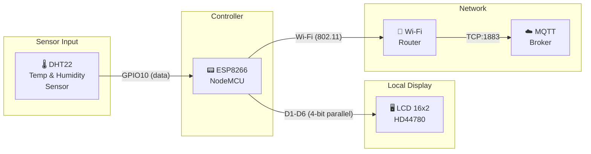

# DHT22 + LCD16x2 — ESP8266 Temperature & Humidity Monitor

An ESP8266-based project that reads temperature and humidity from a **DHT22** sensor, displays the values on a **16x2 LCD**, and publishes them to an **MQTT broker** over Wi-Fi.

## Block Diagram



## Features

- Real-time temperature (°C) and humidity (%) display on a 16x2 LCD
- Wi-Fi connectivity with automatic reconnection
- MQTT publishing to configurable topics (`home/room1/temperature`, `home/room1/humidity`)
- Threshold-based publishing — only sends data when the value changes by ≥ 0.10
- LCD status icons showing Wi-Fi (W) and MQTT (M) connection state (✓ / ✗)

## Hardware

| Component | Details |
|-----------|---------|
| Microcontroller | ESP8266 (e.g. NodeMCU / Wemos D1 Mini) |
| Sensor | DHT22 on pin **GPIO10** (`SD3`) |
| Display | 16x2 LCD (parallel mode) on pins **D1–D6** |

### Wiring

| LCD Pin | ESP8266 Pin |
|---------|-------------|
| RS | D1 |
| EN | D2 |
| D4 | D3 |
| D5 | D4 |
| D6 | D5 |
| D7 | D6 |

## Software Dependencies

| Library | Purpose |
|---------|---------|
| `ESP8266WiFi` | Wi-Fi connectivity |
| `PubSubClient` | MQTT client |
| `DHT` | DHT22 sensor reading |
| `LiquidCrystal` | LCD control |

Install the libraries via the Arduino IDE Library Manager or PlatformIO.

## Configuration

Edit the following constants at the top of [DHT22_and_LCD.ino](DHT22_and_LCD/DHT22_and_LCD.ino) before uploading:

```cpp
const char* WIFI_SSID     = "SSID";
const char* WIFI_PASSWORD = "wifiPass";

const char* MQTT_SERVER   = "broker Ip/Domain";
const uint16_t MQTT_PORT  = 1883;
const char* MQTT_USER     = "USER";
const char* MQTT_PASS     = "PASS";
```

## How It Works

1. **Setup** — Connects to Wi-Fi and the MQTT broker; initialises the DHT22 sensor and LCD.
2. **Loop (every 3 s)** —
   - Reconnects Wi-Fi / MQTT if the connection dropped.
   - Reads temperature and humidity from the DHT22.
   - Updates the LCD with current values and connection status icons.
   - Publishes to MQTT only when a reading changes by at least the configured threshold (0.10).

### LCD Layout

```
T: 25.3°C
H: 48.2%  W:✓ M:✓
```

## License

This project is provided as-is for personal and educational use.
